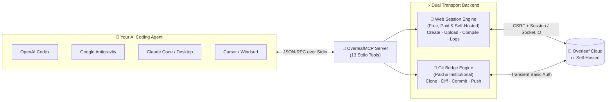

<div align="center">

# 🍃 OverleafMCP

**Let your AI agent create projects, upload LaTeX papers & figures, sync via Git, and fix PDF build errors directly on Overleaf — on both Free and Paid accounts.**

[](https://github.com/ajmainapon/OverleafMCP/releases)
[](https://www.python.org/)
[](https://modelcontextprotocol.io/)
[](https://www.overleaf.com/)
[](./LICENSE)

[**⚡ 30-Second Setup**](#-30-second-setup-pick-your-agent) · [**🔐 Pick Your Auth**](#-step-2-connect-your-overleaf-account) · [**🎬 Live Walkthroughs**](#-interactive-agent-walkthroughs) · [**🧰 13 Tools**](#-tool-explorer-13-tools) · [**❓ Troubleshooting**](#-interactive-troubleshooting-faq)

</div>

---

## ✨ Why OverleafMCP?

Most Overleaf MCP servers rely exclusively on Overleaf's Git Bridge — meaning they **fail on Free accounts**, can't list your projects automatically, can't create new projects, and **can't compile PDFs or read LaTeX error logs**.

**OverleafMCP** combines **both** engines in one server:

| Capability | Manual Browser Workflow | Git-Only MCP Servers | 🍃 **OverleafMCP (Hybrid)** |
| :--- | :---: | :---: | :---: |
| Works on **Free Overleaf** accounts | ✅ | ❌ *(Paid only)* | ✅ **Yes** |
| Works with **Overleaf Git Tokens** | ❌ | ✅ | ✅ **Yes** |
| Auto-discover & list all projects | Manual | ❌ *(Hardcoded IDs)* | ✅ **`overleaf_list_projects`** |
| Create a brand-new project from folder/`.zip` | Manual drag-drop | ❌ | ✅ **`overleaf_create_project`** |
| Upload `.pdf` / `.png` figures & nested folders | Manual | ❌ *(Text only)* | ✅ **`overleaf_upload_folder`** |
| Remote **PDF Compile + LaTeX Log Parser** | Manual click | ❌ | ✅ **`overleaf_compile`** |
| Self-hosted Overleaf CE / Server Pro | ✅ | Partial | ✅ **Configurable `host`** |



---

## ⚡ 30-Second Setup (Pick Your Agent)

> [!TIP]
> **Prerequisite:** Install [**uv**](https://docs.astral.sh/uv/) (`brew install uv` on macOS, or `curl -LsSf https://astral.sh/uv/install.sh | sh`) so `uvx` can launch `overleaf-mcp` with **zero manual cloning or virtualenv setup**.

Click your AI client below to expand its exact setup:

<details open>
<summary><b>🟢 OpenAI Codex (CLI & Codex Desktop App)</b></summary>

**Option 1 — One-liner terminal command:**

```bash
codex mcp add overleaf -- uvx --from git+https://github.com/ajmainapon/OverleafMCP overleaf-mcp
```

**Option 2 — Edit `~/.codex/config.toml` directly** *(Codex uses TOML, not JSON)*:

```toml
[mcp_servers.overleaf]
command = "uvx"
args = ["--from", "git+https://github.com/ajmainapon/OverleafMCP", "overleaf-mcp"]
startup_timeout_sec = 30.0

# Optional: pass credentials via env instead of interactive chat setup
# [mcp_servers.overleaf.env]
# OVERLEAF_COOKIE = "overleaf_session2=s%3A..."
# OVERLEAF_GIT_TOKEN = "olp_..."
```

</details>

<details>
<summary><b>🔵 Google Antigravity</b></summary>

Add to `~/.gemini/config/mcp_config.json`:

```json
{
  "mcpServers": {
    "overleaf": {
      "command": "uvx",
      "args": [
        "--from",
        "git+https://github.com/ajmainapon/OverleafMCP",
        "overleaf-mcp"
      ]
    }
  }
}
```

</details>

<details>
<summary><b>🟠 Claude Code CLI</b></summary>

Run in your terminal:

```bash
claude mcp add overleaf -- uvx --from git+https://github.com/ajmainapon/OverleafMCP overleaf-mcp
```

</details>

<details>
<summary><b>🟣 Claude Desktop (macOS & Windows)</b></summary>

Add to your config file:
- **macOS:** `~/Library/Application Support/Claude/claude_desktop_config.json`
- **Windows:** `%APPDATA%\Claude\claude_desktop_config.json`

```json
{
  "mcpServers": {
    "overleaf": {
      "command": "uvx",
      "args": [
        "--from",
        "git+https://github.com/ajmainapon/OverleafMCP",
        "overleaf-mcp"
      ]
    }
  }
}
```

</details>

<details>
<summary><b>⚫ Cursor / Windsurf</b></summary>

Add to `~/.cursor/mcp.json` (or `.cursor/mcp.json` inside your paper workspace):

```json
{
  "mcpServers": {
    "overleaf": {
      "command": "uvx",
      "args": [
        "--from",
        "git+https://github.com/ajmainapon/OverleafMCP",
        "overleaf-mcp"
      ]
    }
  }
}
```

</details>

<details>
<summary><b>🛠️ Local Clone Setup (Instant Startup / Hacking on the Code)</b></summary>

If you prefer running from a local `.venv` (~100ms cold start, zero network check):

```bash
git clone https://github.com/ajmainapon/OverleafMCP.git
cd OverleafMCP
uv sync
```

Then point your client at `/absolute/path/to/OverleafMCP/.venv/bin/overleaf-mcp` (with `args = []`).

</details>

---

## 🔐 Step 2: Connect Your Overleaf Account

You don't need to edit config files to authenticate — you can tell your agent directly in chat! Pick whichever fits your setup:

<details open>
<summary><b>🅰️ Free or Paid Account — Zero-Copy Browser Login (Chrome / Firefox)</b></summary>

1. Sign into [overleaf.com](https://www.overleaf.com) in **Chrome** or **Firefox**.
2. Ask your agent:
   ```text
   Check my Overleaf authentication status and list my projects.
   ```
3. *(macOS first-run note)* If Keychain prompts to allow reading your browser cookie, click **Always Allow**.

</details>

<details>
<summary><b>🅱️ Free or Paid Account — Paste Session Cookie (Safari / Arc / Brave / Remote)</b></summary>

1. Open [overleaf.com](https://www.overleaf.com) and open Browser DevTools (`Cmd+Option+I` on macOS / `F12` on Windows/Linux).
2. Go to **Application** *(or Storage)* -> **Cookies** -> `https://www.overleaf.com`.
3. Copy the value of **`overleaf_session2`** (starts with `s%3A...`).
4. Paste it to your agent in chat:
   ```text
   Save my Overleaf cookie: s%3A...
   ```
   *(Stored locally at `~/.config/overleaf-mcp/credentials.json` with strict `0600` user-only permissions.)*

</details>

<details>
<summary><b>🅲 Paid / Institutional Account — Permanent Git Bridge Token (Optional)</b></summary>

Combine a Git Token with Web Session (or use Git solo) for clean commit history and non-expiring pushes:

1. Visit [Overleaf Account Settings](https://www.overleaf.com/user/settings) -> **Git Integration** -> **Create Token**.
2. Tell your agent:
   ```text
   Save my Overleaf Git token: olp_...
   ```

</details>

<details>
<summary><b>🅳 Self-Hosted Overleaf (Community Edition / Server Pro)</b></summary>

Point OverleafMCP to your institution or lab server:

```text
Configure Overleaf host to latex.my-university.edu with my cookie s%3A...
```

</details>

---

## 🎬 Interactive Agent Walkthroughs

Once connected, reference projects by **exact title**, **full Overleaf URL**, or **24-char ID**. Expand any workflow to see how the agent uses the tools behind the scenes:

<details open>
<summary><b>🚀 Walkthrough 1: Turn a Local Folder into a Compiled Overleaf Project</b></summary>

> **You:** *"Create a new Overleaf project called `ICML 2027 Paper` from `./my-paper`, compile it, and save the PDF to `./icml_draft.pdf`."*
>
> **Agent actions:**
> 1. Calls `overleaf_create_project(project_name="ICML 2027 Paper", source_path="./my-paper")` -> auto-zips `.tex`, `.bib`, and `figures/` while skipping `.git`, `.DS_Store`, and `*.aux`.
> 2. Calls `overleaf_compile(project="67f0...", save_pdf_path="./icml_draft.pdf")` -> triggers remote Overleaf CLSI build and downloads `icml_draft.pdf`.
>
> **Agent reply:** *"Created **ICML 2027 Paper** (`https://www.overleaf.com/project/67f0...`), compiled cleanly with 0 errors, and saved `./icml_draft.pdf` (14 pages)."*

</details>

<details>
<summary><b>🩺 Walkthrough 2: Autonomous Compile -> Read Log -> Fix LaTeX Error Loop</b></summary>

> **You:** *"Upload my updated `sections/method.tex` to `ICML 2027 Paper`, compile on Overleaf, and fix any LaTeX build errors."*
>
> **Agent actions:**
> 1. Calls `overleaf_upload_file(project="ICML 2027 Paper", local_path="sections/method.tex", remote_path="sections/method.tex")`.
> 2. Calls `overleaf_compile(project="ICML 2027 Paper")` -> receives `diagnostics.errors`:
>    ```text
>    ! Undefined control sequence.
>    l.84 \mathcalb{L}_{total}
>    ```
> 3. Fixes `\mathcalb` -> `\mathcal` locally, re-uploads `sections/method.tex`, and re-runs `overleaf_compile` until `error_count == 0`.

</details>

<details>
<summary><b>🌿 Walkthrough 3: Sync Collaborator Edits Back to Your Laptop</b></summary>

> **You:** *"My co-author edited our Overleaf paper — pull the latest version of `ICML 2027 Paper` into `./my-paper-synced`."*
>
> **Agent actions:**
> - On **Free/Paid** accounts: calls `overleaf_pull_project(project="ICML 2027 Paper", output_dir="./my-paper-synced", method="zip")`.
> - On **Paid/Institutional** accounts: calls `overleaf_pull_project(..., method="git")` to `git clone` / `git pull --rebase` with full commit history!

</details>

---

## 🧰 Tool Explorer (13 Tools)

<details>
<summary><b>🔐 Authentication & Account Discovery (3 tools)</b></summary>

| Tool | Auth | What It Does |
| :--- | :--- | :--- |
| `overleaf_auth_status` | Both | Verifies live Web Session & Git Token readiness and reports accessible project count. |
| `overleaf_configure_auth` | Both | Saves `cookie`, `git_token`, `host`, or `git_host` to `~/.config/overleaf-mcp/credentials.json` (`0600`). |
| `overleaf_list_projects` | Web | Lists all Overleaf projects with IDs, titles, access levels, timestamps, and editor URLs. |

</details>

<details open>
<summary><b>📤 Project Creation, Upload & File Editing (6 tools)</b></summary>

| Tool | Auth | What It Does |
| :--- | :--- | :--- |
| `overleaf_create_project` | Web | Creates a brand-new project (blank, example, `.zip`, or auto-zipped from a local folder). |
| `overleaf_upload_file` | Web | Uploads any local file (`.tex`, `.bib`, `.pdf`, `.png`, `.eps`) and auto-creates remote folders. |
| `overleaf_upload_folder` | Hybrid | Recursively uploads a local folder via Web Session (`method="web"`) or Git Bridge (`method="git"` / `"auto"`). |
| `overleaf_write_file` | Web | Writes UTF-8 text content directly to a remote `.tex` / `.bib` / `.sty` path without needing a local file. |
| `overleaf_list_files` | Web | Returns the complete nested folder and file tree of a project. |
| `overleaf_delete_path` | Web | Deletes a remote file or folder inside a project. |

</details>

<details open>
<summary><b>📥 Pull, Git Sync & Remote PDF Compilation (4 tools)</b></summary>

| Tool | Auth | What It Does |
| :--- | :--- | :--- |
| `overleaf_read_file` | Web | Reads remote text/LaTeX files (`doc` & `file` entities) or downloads binary files locally. |
| `overleaf_pull_project` | Hybrid | Downloads & extracts an entire Overleaf project via `.zip` or `git clone`/`pull`. |
| `overleaf_compile` | Web | Triggers remote Overleaf compilation, extracts `! LaTeX Error` lines & warnings from `output.log`, and downloads `output.pdf`. |
| `overleaf_git_sync` | Git | Runs `clone`, `pull`, `status`, or `push` directly against Overleaf's Git Bridge. |

</details>

---

## 🔒 Security Architecture

> [!IMPORTANT]
> Treat your `overleaf_session2` cookie and `olp_...` Git token like passwords — both grant read/write access to your Overleaf projects.

- **Strict `0600` Credential Storage:** `overleaf_configure_auth` writes `~/.config/overleaf-mcp/credentials.json` with `rw-------` permissions.
- **Zero Plaintext Tokens in `.git/config`:** Git operations inject transient `git -c http.extraHeader="Authorization: Basic ..."` headers per command and scrub tokens from stderr/stdout logs.
- **Stdio Protocol Isolation:** Browser cookie loaders redirect `stdout -> stderr` so OS keyring messages never corrupt JSON-RPC framing in strict clients like Codex.
- **Zip-Slip & Path Containment:** Archive extraction enforces `Path.is_relative_to()` to block `..` and sibling-prefix traversal.

---

## ❓ Interactive Troubleshooting FAQ

<details>
<summary><b>"Overleaf session is not authenticated (redirected to /login)"</b></summary>

Overleaf browser cookies (`overleaf_session2`) expire periodically or when you log out. Simply open [overleaf.com](https://www.overleaf.com) in your browser to refresh your login (or paste a fresh `overleaf_session2` cookie via `overleaf_configure_auth`).

</details>

<details>
<summary><b>Codex / Claude says tools timed out on the very first run</b></summary>

On the very first `uvx` launch, `uv` downloads dependencies and builds the cached wheel (~5–10 seconds). Subsequent launches take ~150ms. In Codex (`~/.codex/config.toml`), set `startup_timeout_sec = 30.0` (or run from a local clone `.venv/bin/overleaf-mcp`).

</details>

<details>
<summary><b>Does `overleaf_git_sync` work on a Free Overleaf account?</b></summary>

No — Overleaf restricts its `git.overleaf.com` bridge to Paid, Student/Institutional, and Server Pro plans. On a **Free** account, use `overleaf_upload_folder(..., method="web")`, `overleaf_upload_file`, `overleaf_pull_project(..., method="zip")`, and `overleaf_compile` — all of which work on Free accounts!

</details>

---

## 🧪 Development & Testing

```bash
git clone https://github.com/ajmainapon/OverleafMCP.git
cd OverleafMCP
uv sync
.venv/bin/python tests/test_server.py
```

## 📄 License

Released under the [MIT License](./LICENSE).
