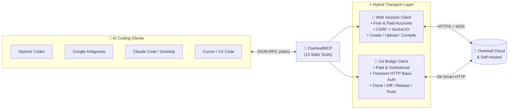
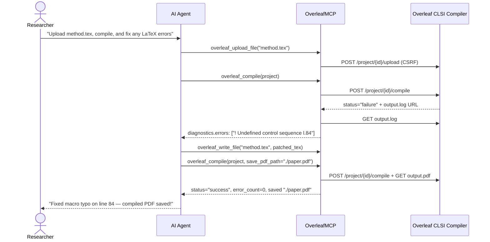

<div align="center">

<a id="readme-top"></a>


# OverleafMCP

### **Autonomous Overleaf Workflows for AI Coding Agents**

Create Overleaf projects from local folders, upload `.tex` papers & figures, sync via Git Bridge, and run **self-healing remote PDF builds** — on both **Free** and **Paid** Overleaf accounts.

[](https://github.com/ajmainapon/OverleafMCP/actions/workflows/ci.yml)
[](https://github.com/ajmainapon/OverleafMCP/releases)
[](https://www.python.org/)
[](https://modelcontextprotocol.io/)
[](https://www.overleaf.com/)
[](./LICENSE)

[**⚡ 30-Sec Install**](#-30-second-install-choose-your-agent) · [**🔐 Auth Picker**](#-connect-your-overleaf-account) · [**📋 Copy-Paste Prompts**](#-copy-paste-prompt-playbook) · [**🧠 How It Works**](#-architecture--self-healing-compile-loop) · [**🧰 13 Tools**](#-complete-tool-explorer-13-tools) · [**❓ FAQ**](#-interactive-troubleshooting-faq)

<br />



</div>

---

## ✨ Why OverleafMCP?

Overleaf has **no public REST API**, and community Git-only MCP servers break on **Free Overleaf accounts**, cannot list your projects automatically, cannot create new projects, and **cannot compile PDFs or read LaTeX error logs**.

**OverleafMCP** unifies **Web Session** and **Git Bridge** under a single 13-tool MCP server:

| Capability | Manual Browser | Git-Only MCPs | 🍃 **OverleafMCP (Hybrid)** |
| :--- | :---: | :---: | :---: |
| Works on **Free Overleaf** accounts | ✅ | ❌ *(Paid only)* | ✅ **Yes (Browser / Cookie)** |
| Works with **Permanent Git Tokens** (`olp_...`) | ❌ | ✅ | ✅ **Yes (Transient Basic Auth)** |
| Auto-discover & resolve projects by **Title or URL** | Manual | ❌ *(Hardcoded IDs)* | ✅ **`overleaf_list_projects`** |
| Bootstrap brand-new project from **local folder / `.zip`** | Drag & drop | ❌ | ✅ **`overleaf_create_project`** |
| Upload binary figures (`.pdf`, `.png`) & nested folders | Manual | ❌ *(Text only)* | ✅ **`overleaf_upload_folder`** |
| Remote **PDF Compile + Structured `output.log` Parser** | Manual click | ❌ | ✅ **`overleaf_compile`** |
| Self-hosted **Overleaf CE / Institutional Server Pro** | ✅ | Partial | ✅ **Custom `host` & `git_host`** |

---

## ⚡ 30-Second Install (Choose Your Agent)

> [!TIP]
> **One-time prerequisite:** Install [**uv**](https://docs.astral.sh/uv/) (`brew install uv` on macOS, or `curl -LsSf https://astral.sh/uv/install.sh | sh`) so `uvx` runs `overleaf-mcp` directly from GitHub with **zero manual cloning**.

Click your AI coding tool below to expand copy-ready instructions:

<details open>
<summary><b>🟢 OpenAI Codex (CLI &amp; Codex Desktop App)</b></summary>

**Option A — One-liner terminal command:**

```bash
codex mcp add overleaf -- uvx --from git+https://github.com/ajmainapon/OverleafMCP overleaf-mcp
```

**Option B — Add to `~/.codex/config.toml`** *(Codex uses TOML, not JSON)*:

```toml
[mcp_servers.overleaf]
command = "uvx"
args = ["--from", "git+https://github.com/ajmainapon/OverleafMCP", "overleaf-mcp"]
startup_timeout_sec = 30.0

# Optional: pass credentials via env instead of configuring in chat
# [mcp_servers.overleaf.env]
# OVERLEAF_COOKIE = "overleaf_session2=s%3A..."
# OVERLEAF_GIT_TOKEN = "olp_..."
```

</details>

<details>
<summary><b>🔵 Google Antigravity</b></summary>

Add to `~/.gemini/config/mcp_config.json`:

```json
{
  "mcpServers": {
    "overleaf": {
      "command": "uvx",
      "args": [
        "--from",
        "git+https://github.com/ajmainapon/OverleafMCP",
        "overleaf-mcp"
      ]
    }
  }
}
```

</details>

<details>
<summary><b>🟠 Claude Code CLI</b></summary>

```bash
claude mcp add overleaf -- uvx --from git+https://github.com/ajmainapon/OverleafMCP overleaf-mcp
```

</details>

<details>
<summary><b>🟣 Claude Desktop (macOS &amp; Windows)</b></summary>

Open your Claude Desktop configuration file:
- **macOS:** `~/Library/Application Support/Claude/claude_desktop_config.json`
- **Windows:** `%APPDATA%\Claude\claude_desktop_config.json`

```json
{
  "mcpServers": {
    "overleaf": {
      "command": "uvx",
      "args": [
        "--from",
        "git+https://github.com/ajmainapon/OverleafMCP",
        "overleaf-mcp"
      ]
    }
  }
}
```

</details>

<details>
<summary><b>⚫ Cursor / Windsurf</b></summary>

Add to `~/.cursor/mcp.json` (global) or `.cursor/mcp.json` (project workspace):

```json
{
  "mcpServers": {
    "overleaf": {
      "command": "uvx",
      "args": [
        "--from",
        "git+https://github.com/ajmainapon/OverleafMCP",
        "overleaf-mcp"
      ]
    }
  }
}
```

</details>

<details>
<summary><b>🔷 VS Code (GitHub Copilot Agent Mode)</b></summary>

Create `.vscode/mcp.json` in your workspace:

```json
{
  "servers": {
    "overleaf": {
      "type": "stdio",
      "command": "uvx",
      "args": [
        "--from",
        "git+https://github.com/ajmainapon/OverleafMCP",
        "overleaf-mcp"
      ]
    }
  }
}
```

</details>

<details>
<summary><b>⚡ Local `.venv` Install (~100ms Instant Cold Start / Contributors)</b></summary>

```bash
git clone https://github.com/ajmainapon/OverleafMCP.git
cd OverleafMCP
uv sync
```

Point your MCP client's `command` directly to `/absolute/path/to/OverleafMCP/.venv/bin/overleaf-mcp` with empty `args: []`.

</details>

---

## 🔐 Connect Your Overleaf Account

Not sure which auth mode to pick? Use this quick guide:

- **Using Chrome or Firefox on Free/Paid Overleaf?** -> Expand **Mode A** *(zero copy-paste!)*
- **Using Safari, Arc, Brave, or a remote Linux server?** -> Expand **Mode B** *(paste `overleaf_session2`)*
- **Have Overleaf Paid / Student / Institutional plan?** -> Add **Mode C** *(permanent `olp_...` Git token)*

<details open>
<summary><b>🅰️ Mode A: Zero-Copy Browser Auto-Login (Chrome &amp; Firefox · Free &amp; Paid)</b></summary>

1. Sign into [overleaf.com](https://www.overleaf.com) in **Chrome** or **Firefox**.
2. Send this prompt to your agent:
   ```text
   Check my Overleaf authentication status and list my projects.
   ```
3. *(macOS first-run)* Click **Always Allow** if Keychain asks permission to read your browser cookie.

</details>

<details>
<summary><b>🅱️ Mode B: Paste `overleaf_session2` Cookie (Safari / Arc / Brave / Headless · Free &amp; Paid)</b></summary>

1. Open [overleaf.com](https://www.overleaf.com) -> open DevTools (`Cmd+Option+I` or `F12`).
2. Navigate to **Application** *(or Storage)* -> **Cookies** -> `https://www.overleaf.com`.
3. Copy the value of **`overleaf_session2`** (begins with `s%3A...`).
4. Paste it directly to your agent in chat:
   ```text
   Save my Overleaf cookie: s%3A...
   ```
   *(Saved locally with `0600` user-only permissions at `~/.config/overleaf-mcp/credentials.json`.)*

</details>

<details>
<summary><b>🅲 Mode C: Permanent Git Bridge Token (Paid / Institutional / Server Pro)</b></summary>

1. Open [Overleaf Account Settings](https://www.overleaf.com/user/settings) -> **Git Integration** -> **Create Token**.
2. Tell your agent:
   ```text
   Save my Overleaf Git token: olp_...
   ```

</details>

<details>
<summary><b>⚙️ Environment Variables Reference (Optional for CI / Docker / Config Files)</b></summary>

All environment variables override `~/.config/overleaf-mcp/credentials.json` when set:

| Variable | Default | Description |
| :--- | :--- | :--- |
| `OVERLEAF_COOKIE` | *(Browser auto-load)* | `overleaf_session2=s%3A...` (or bare `s%3A...` value, or `"browser"`). |
| `OVERLEAF_GIT_TOKEN` | `None` | Overleaf Git Bridge token (`olp_...`) from Account Settings. |
| `OVERLEAF_HOST` | `www.overleaf.com` | Overleaf web domain (set to your self-hosted domain for Overleaf CE/Pro). |
| `OVERLEAF_GIT_HOST` | `git.overleaf.com` | Overleaf Git host (auto-derived from `OVERLEAF_HOST` when omitted). |
| `OVERLEAF_MCP_CONFIG_DIR` | `~/.config/overleaf-mcp` | Directory storing `credentials.json` (`0600`). |
| `OVERLEAF_MCP_GIT_DIR` | `~/.cache/overleaf-mcp/repos` | Cache directory for Git Bridge checkouts. |

</details>

---

## 📋 Copy-Paste Prompt Playbook

Click the copy icon in the top-right corner of any prompt below and drop it straight into your agent:

<details open>
<summary><b>📦 1. Bootstrap a Brand-New Overleaf Project from a Local Paper</b></summary>

```text
Create a new Overleaf project called "NeurIPS 2027 Submission" from ./paper, compile it on Overleaf, and download the compiled PDF to ./neurips_draft.pdf.
```

</details>

<details open>
<summary><b>🩺 2. Self-Healing Compile &amp; Fix LaTeX Errors Automatically</b></summary>

```text
Upload my local sections/ folder to my Overleaf project "NeurIPS 2027 Submission", run overleaf_compile, inspect any errors or undefined citations in diagnostics, fix them in the .tex files, and re-compile until there are 0 errors.
```

</details>

<details>
<summary><b>📊 3. Push Fresh Experiment Plots &amp; Regenerate PDF</b></summary>

```text
Upload all PDFs and PNGs inside ./experiments/plots to the figures/ folder of https://www.overleaf.com/project/<YOUR_PROJECT_ID> and recompile the paper.
```

</details>

<details>
<summary><b>🤝 4. Pull Co-Author Changes Back to Your Local Workspace</b></summary>

```text
Pull the latest files from my Overleaf project "NeurIPS 2027 Submission" into ./paper-latest and summarize what changed in main.tex.
```

</details>

---

## 🧠 Architecture & Self-Healing Compile Loop

<details open>
<summary><b>🗺️ Dual-Engine System Architecture (Click to toggle)</b></summary>



</details>

<details>
<summary><b>🔄 Autonomous Compile -> Parse Log -> Fix Loop (Sequence Diagram)</b></summary>



</details>

---

## 🧰 Complete Tool Explorer (13 Tools)

Every project tool accepts a **24-character Project ID**, a **full Overleaf project URL**, or an **exact Project Title**.

<details>
<summary><b>🔐 Auth &amp; Project Discovery (`overleaf_auth_status`, `overleaf_configure_auth`, `overleaf_list_projects`)</b></summary>

| Tool | Key Parameters | Auth | Description |
| :--- | :--- | :---: | :--- |
| `overleaf_auth_status` | `verify_live: bool = True` | Both | Verifies Web Session & Git Token validity and counts accessible projects. |
| `overleaf_configure_auth` | `cookie`, `git_token`, `host`, `git_host` | Both | Writes credentials/hosts to `~/.config/overleaf-mcp/credentials.json` (`0600`). |
| `overleaf_list_projects` | `include_archived`, `include_trashed` | Web | Lists projects with `id`, `name`, `access_level`, `last_updated`, and `editor_url`. |

</details>

<details open>
<summary><b>📤 Create, Upload &amp; Mutate (`overleaf_create_project`, `overleaf_upload_file`, `overleaf_upload_folder`, `overleaf_write_file`, `overleaf_delete_path`)</b></summary>

| Tool | Key Parameters | Auth | Description |
| :--- | :--- | :---: | :--- |
| `overleaf_create_project` | `project_name`, `source_path=None`, `template="none"` | Web | Creates blank/example project or auto-zips & uploads a local directory/`.zip` (with automatic folder-upload fallback). |
| `overleaf_upload_file` | `project`, `local_path`, `remote_path=None` | Web | Uploads any text or binary file (`.tex`, `.bib`, `.pdf`, `.png`) and creates missing parent folders. |
| `overleaf_upload_folder` | `project`, `local_dir`, `remote_dir=""`, `method="auto"` | Hybrid | Uploads a directory tree via Web API (`"web"`) or Git Bridge (`"git"` / `"auto"`), skipping `.git`, `.DS_Store`, `*.aux`, etc. |
| `overleaf_write_file` | `project`, `remote_path`, `content` | Web | Creates or overwrites a UTF-8 file directly in Overleaf from memory. |
| `overleaf_delete_path` | `project`, `remote_path` | Web | Deletes a remote file or directory inside a project. |

</details>

<details open>
<summary><b>📥 Read, Pull, Git Sync &amp; Compile (`overleaf_list_files`, `overleaf_read_file`, `overleaf_pull_project`, `overleaf_compile`, `overleaf_git_sync`)</b></summary>

| Tool | Key Parameters | Auth | Description |
| :--- | :--- | :---: | :--- |
| `overleaf_list_files` | `project` | Web | Lists the full hierarchical tree of folders, `doc` text entities, and binary `file` entities. |
| `overleaf_read_file` | `project`, `remote_path`, `save_to_path=None` | Web | Reads `.tex`/`.bib` content as UTF-8 text or saves binary files locally. |
| `overleaf_pull_project` | `project`, `output_dir`, `method="zip"` | Hybrid | Downloads & extracts an entire Overleaf project via `.zip` (`"zip"`) or Git (`"git"`). |
| `overleaf_compile` | `project`, `save_pdf_path=None`, `draft=False`, `root_doc_path=None` | Web | Runs Overleaf's remote LaTeX compiler, parses errors/warnings from `output.log`, and saves `output.pdf`. |
| `overleaf_git_sync` | `action` (`clone`\|`pull`\|`status`\|`push`), `project_id`, `local_dir` | Git | Direct Git Bridge operations with automatic `pull --rebase` conflict recovery. |

</details>

---

## 🛡️ Security & Reliability Highlights

> [!IMPORTANT]
> Both `overleaf_session2` cookies and `olp_...` Git tokens grant read/write access to your Overleaf projects — never commit them to version control.

- **User-Only `0600` Credential Vault:** `overleaf_configure_auth` stores secrets at `~/.config/overleaf-mcp/credentials.json` (`chmod 600`).
- **Zero Plaintext Tokens in `.git/config`:** Git Bridge calls inject transient `git -c http.extraHeader="Authorization: Basic ..."` headers per invocation and scrub tokens from error output.
- **Deterministic WebSocket Cleanup:** Fixes `pyoverleaf`'s Socket.IO connection leak by guaranteeing `socket.close()` inside `finally` blocks across long multi-step sessions.
- **Strict Stdio Isolation:** Browser keyring/cookie loaders redirect `stdout -> stderr` so third-party warnings never corrupt JSON-RPC framing in strict clients like Codex.
- **Zip-Slip Traversal Defense:** Archive extraction enforces `Path.is_relative_to()` containment against `..` and sibling-prefix attacks.

---

## ❓ Interactive Troubleshooting FAQ

<details>
<summary><b>Why did I get <code>Overleaf session is not authenticated (redirected to /login)</code>?</b></summary>

Overleaf browser session cookies (`overleaf_session2`) expire periodically or when you sign out. Open [overleaf.com](https://www.overleaf.com) in Chrome/Firefox to refresh your login, or paste a fresh `overleaf_session2` cookie in chat (`Save my Overleaf cookie: s%3A...`).

</details>

<details>
<summary><b>Codex timed out on the very first startup — how do I fix it?</b></summary>

On the first `uvx` invocation, `uv` resolves and caches dependencies (~5–10s). Set `startup_timeout_sec = 30.0` under `[mcp_servers.overleaf]` in `~/.codex/config.toml` (subsequent launches take ~150ms), or run from a local clone `.venv/bin/overleaf-mcp`.

</details>

<details>
<summary><b>Can I use <code>overleaf_git_sync</code> on a Free Overleaf account?</b></summary>

Overleaf restricts `git.overleaf.com` to Paid, Student/Institutional, and Server Pro plans. On a **Free** account, use `overleaf_create_project`, `overleaf_upload_file`, `overleaf_upload_folder(..., method="web")`, `overleaf_pull_project(..., method="zip")`, and `overleaf_compile` — all of which work on Free accounts!

</details>

<details>
<summary><b>What happens if my uploaded folder doesn't have a top-level <code>main.tex</code> yet?</b></summary>

Overleaf's `.zip` project importer rejects archives without a `.tex` root file (`HTTP 422`). `overleaf_create_project` automatically catches this and falls back to creating a blank project and uploading your directory tree file-by-file!

</details>

---

## 🧪 Local Development & CI Tests

```bash
git clone https://github.com/ajmainapon/OverleafMCP.git
cd OverleafMCP
uv sync
uv run python tests/test_server.py
```

---

<div align="center">

Released under the [**MIT License**](./LICENSE) · Built by [**Ajmain Istiak Apon**](https://github.com/ajmainapon)

[**⬆ Back to Top**](#readme-top)

</div>
